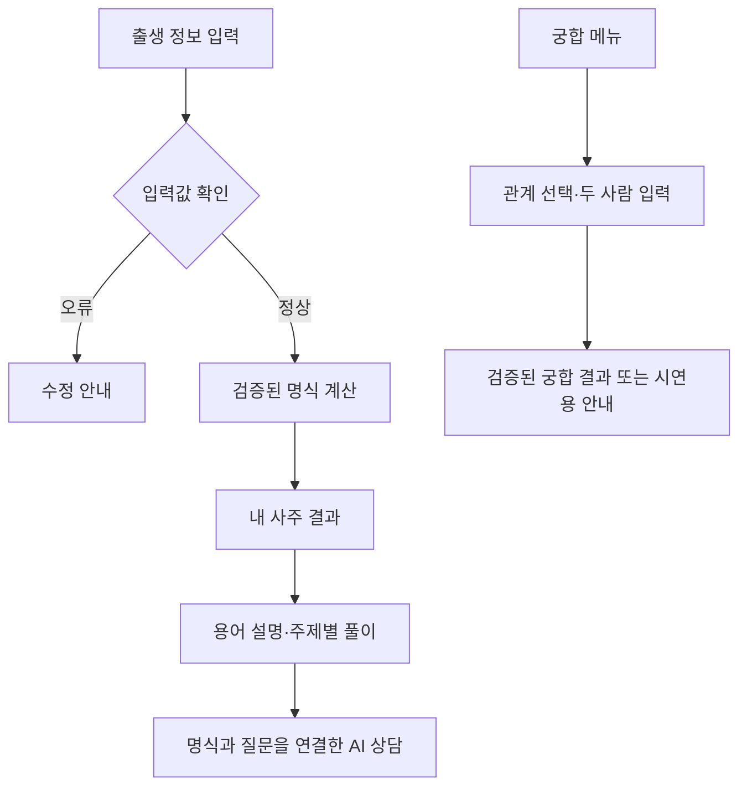

# 포포(POPO) ✦

**AI 사주 상담 웹 서비스**

> 나를 읽는 AI 사주 상담

개인 프로젝트 · 서비스 기획 / MVP 개발 준비 및 인터랙티브 웹 목업 공개  
진행 기간: 2026.10.29 ~ 2026.11.10 (1차 구현·검증 목표)  
기록 기준일: 2026-10-29

**현재 확인할 수 있는 것:** 출생 정보 입력, 명식·풀이 예시, 캐릭터·토정비결 미리보기, AI 상담 예시를 클릭형 웹 화면으로 볼 수 있습니다.  
**아직 구현하지 않은 것:** 실제 사주 계산, AI 모델 연동, 관계별 궁합, 상담 기록 저장, 사용자 인터뷰·사용성 테스트입니다.

**[웹 시안 체험하기](https://momoorr.github.io/POPO/)** · **[프로젝트 계획서 v1.0](docs/16-project-plan.md)**

---

## 1. 프로젝트 소개

포포는 사용자가 자신의 사주를 쉽게 이해하고, 연애·직업·재물 등 관심 있는 주제의 풀이를 읽은 뒤 AI에게 추가 질문할 수 있도록 기획한 웹 서비스입니다.

처음에는 사주 정보를 얼마나 자세히 보여줄지 고민했습니다. 지금은 정보를 많이 나열하기보다 **원하는 항목을 쉽게 찾고, 어려운 용어를 그 자리에서 이해하고, 이어서 질문할 수 있는 흐름**에 집중하고 있습니다.

대표 캐릭터는 **긴 속눈썹과 살짝 새침한 눈매를 가진 달토끼 ‘포포’**로 정했습니다. 달에서 방아를 찧는 대표 일러스트를 새로 제작할 계획입니다. 현재 웹 시안의 캐릭터는 변경 전 콘셉트이며, 새 캐릭터가 적용된 상태는 아닙니다.

현재는 화면 목업과 기획 문서를 공개했고, 실제 계산·AI 상담 기능은 개발 전입니다.

## 2. 문제 정의와 근거

삐삐사주 등 기존 서비스의 공개 자료와 화면을 참고하며 다음 문제를 가설로 정리했습니다.

| 구분 | 현재 판단 |
|---|---|
| 확인한 내용 | 기존 사주 서비스는 명식, 용어 설명, 관계별 궁합, 캐릭터 등 다양한 콘텐츠를 제공합니다. |
| 문제 가설 1 | 명리학을 모르는 사용자는 일간·오행·십성 같은 용어를 이해하기 어려울 수 있습니다. |
| 문제 가설 2 | 긴 풀이를 모두 읽기보다 자신이 궁금한 주제부터 찾아보길 원할 수 있습니다. |
| 문제 가설 3 | 정해진 설명을 읽고 생긴 질문을 같은 명식 정보로 이어가고 싶을 수 있습니다. |
| 문제 가설 4 | 궁합을 단순한 점수보다 관계별 특징과 대화 방법으로 이해하고 싶을 수 있습니다. |
| 검증이 필요한 것 | 실제 사용자 불편, 선호하는 탐색 방식, 설명의 이해도와 상담 전환 경험 |

사용자 문제는 **아직 인터뷰로 확인하지 않은 가설**입니다. 경쟁사 화면을 참고하되 포포의 캐릭터·문구·화면을 그대로 복제하지 않고 자체적으로 구성할 계획입니다.

자세한 내용: [프로젝트 개요](docs/01-product-brief.md) · [경쟁 서비스 검토](docs/09-competitive-benchmark.md)

## 3. 핵심 기능과 구현 상태

| 기능 | 현재 상태 | 11월 10일까지의 목표 또는 후속 계획 |
|---|---|---|
| 홈·모바일 화면 | 클릭형 목업 공개 | 달토끼 캐릭터 적용, 주요 메뉴와 반응형 UI 개선 |
| 출생 정보 입력 | 화면 시안 | 양·음력, 날짜·시간·지역 검증 및 지원 범위 안내 |
| 내 사주·명식 | 예시 데이터 | 검증된 계산 모듈로 가능한 범위의 사주 원국·오행 표시 |
| 명리 용어 설명 | 상세 팝업 추가 기획 | 일간·오행·십성 등을 누르면 쉬운 설명과 심화 설명 제공 |
| 종합·주제별 풀이 | 예시 화면 | 종합·연애·재물·직업·인간관계 기본/심화 풀이 연결 |
| AI 사주 상담 | 가상 답변 시연 | 서버 측 모델 연동, 명식·선택 주제 전달, 오류·재시도 처리 |
| 관계별 궁합 | 신규 기능 기획 | 연인·배우자·가족·친구 선택 및 두 사람 입력·결과 흐름. 계산 규칙 검증에 따라 실제 기능/시연용 구분 |
| 오늘의 운세·대운·세운 | 일부 기획·시안 | 계산·해석 규칙 검증 후 업데이트 |
| 토정비결·타로 | 기획·일부 미리보기 | 별도 정책 검증 후 업데이트 |
| 60갑자 동물 캐릭터 | 일주 ID 60개 정리 | 전체 캐릭터 일러스트 제작은 후속 업데이트 |
| 회원·상담 기록 | 미구현 | 개인정보 보관·삭제 정책 결정 후 검토 |

**1차 우선순위:** 출생 정보 입력 → 검증된 명식 조회 → 용어·기본/심화 풀이 → AI 후속 상담입니다. 궁합은 기본 이용 흐름을 추가로 구현하되, 계산 규칙이 검증되지 않으면 시연용이라고 표시합니다.

실제 기능은 **사용 가능 / 시연용 / 준비 중**으로 구분합니다. 예시 데이터를 실제 계산 결과나 AI 응답인 것처럼 보여주지 않습니다.

자세한 내용: [PRD 기준선](docs/02a-prd-v0.3-baseline-summary.md) · [기능 확장안](docs/02-prd-v0.4-proposal.md) · [프로젝트 계획서](docs/16-project-plan.md)

## 4. 서비스 흐름

**현재 목업에서 확인할 수 있는 흐름**

```text
홈 → 출생 정보 입력 화면 → 명식·풀이 예시 → AI 상담 예시
                           └→ 캐릭터·운세·토정비결 미리보기
```

**1차 구현 목표 흐름**



명식 계산은 AI가 직접 수행하지 않고 별도 계산 모듈이 처리합니다. 궁합은 **연인·배우자·가족·친구**를 지원하는 방향으로 설계하며, 단순 점수보다 관계 특징·갈등 요인·대화 팁을 보여주려 합니다.

상세 자료: [IA·사용자 흐름](docs/04-ia-and-flows.md) · [계산·해석 정책](docs/07-calculation-content-policy.md)

## 5. 사용 도구

| 도구 | 현재 사용한 범위 |
|---|---|
| GitHub·Markdown | 기획 문서 관리, 변경 이력, 포트폴리오 공개 |
| HTML·CSS·JavaScript | 클릭할 수 있는 웹 화면 목업 |
| GitHub Pages | 정적 웹 목업 공개 |
| CSV·Python 스크립트 | 기능·테스트 자료 정리, 정적 파일 구조 점검 |
| ChatGPT | 기획 문서 정리, UI 목업과 발표자료 제작 지원 |

실제 역법 계산 라이브러리, AI 모델·서버 API, 운영 데이터베이스는 아직 선정·연동을 완료하지 않았습니다.

## 6. 검증 현황

| 검증 항목 | 현재 확인한 결과 | 남은 작업 |
|---|---|---|
| GitHub Pages 배포 | 클릭형 웹 시안 공개 | 모바일 주요 화면과 링크 추가 점검 |
| 입력·화면 전환 | 궁합 날짜 누락 차단과 관계별 결과 전환을 일부 수동 확인 | 다른 입력 오류·배우자/가족 시나리오 추가 검증 |
| 명식 계산 | 미구현 | 절기·윤달·자시·시간 미상 등 정책 및 경계 테스트 |
| 명리 용어 설명 | 일간 팝업과 심화 접기/펼치기, Esc/Enter 동작 수동 확인 | 오행 등 다른 용어·키보드 접근성 추가 검증 |
| 명리 풀이·AI 상담 | 예시 데이터/응답 화면 | 실제 계산값과 응답 연결, 근거·안전성 검증 |
| 궁합 | 시연용 결과 화면에서 연인·친구 카테고리 제목 변경 확인 | 나머지 유형과 실제 계산·개인정보 정책 검증 |
| 사용자 인터뷰·사용성 테스트 | 미실시 | 질문지·과제 확정 후 실제 수행 및 개선 기록 |

2026년 10월 30일 기준 **UX 기능 테스트 12건 중 PASS 3건, 일부 조건 확인 3건, 미실행 6건**을 기록했습니다. 이는 클릭형 목업의 **사용자 수동 테스트** 결과이며, 실제 사주·궁합 계산이나 AI 연동을 검증한 결과는 아닙니다. 확인된 세 가지 UX 개선 사항은 아직 미수정 상태입니다.

참고: [QA 시나리오](qa/03-ux-v0.8-test-cases.csv) · [수동 실행 기록](qa/04-ux-v0.9.2-execution-log.md) · [UX 개선 기록](docs/18-ux-improvement-log.md) · [AI 상담 평가 계획](docs/12-ai-evaluation-plan.md)

## 7. 산출물 안내

| 영역 | 관련 자료 |
|---|---|
| 프로젝트 계획 | [프로젝트 계획서 v1.0](docs/16-project-plan.md) |
| 문제 정의 | [서비스 개요](docs/01-product-brief.md) · [경쟁사 검토](docs/09-competitive-benchmark.md) |
| 기능·요구사항 | [PRD 기준선](docs/02a-prd-v0.3-baseline-summary.md) · [기능 확장 제안](docs/02-prd-v0.4-proposal.md) · [기능 목록](docs/03-feature-catalog.csv) |
| 설계 | [정보 구조·사용자 흐름](docs/04-ia-and-flows.md) · [화면설계 보완](docs/10-screen-spec-addendum.md) · [디자인 원칙](docs/06-design-system.md) |
| 캐릭터 | [60갑자 캐릭터 체계](docs/05-character-system.md) · [일주 ID 목록](data/60-day-pillar-character-map.csv) |
| 테스트·검증 | [요구사항·테스트 추적표](docs/11-requirement-test-evidence-matrix.csv) · [QA 시나리오](qa/01-test-cases.csv) · [인터뷰 계획](research/01-interview-guide.md) |
| 진행 관리 | [기획 의사결정](docs/08-decision-log.md) · [진행 상태표](PROGRESS.md) |
| 기업 제출 | [프로젝트 요약](portfolio/PROJECT_SUMMARY.md) · [포트폴리오 PDF](portfolio/포포_기업제출용_서비스기획_포트폴리오_v0.6.pdf) · [PPT](portfolio/포포_기업제출용_서비스기획_포트폴리오_v0.6.pptx) |

상세 정책과 작업 기록은 [`docs/`](docs/)에서 관리하고 있습니다. 기존 PPT와 하위 문서 일부는 **새로 결정한 달토끼·궁합 방향이 아직 반영되지 않은 이전 버전**입니다. 실제 수정 후 갱신할 예정입니다.

## 8. 현재 구성과 테스트 방법

**[웹 시안 열어보기](https://momoorr.github.io/POPO/prototype/index.html)**

1. 웹 시안에서 홈·출생 정보 입력·명식 결과·카테고리 이동을 확인합니다.
2. 기본·심화 풀이와 AI 상담 응답 예시를 살펴봅니다.
3. 실제 사주 계산 및 실시간 AI 응답은 아직 동작하지 않는다는 점을 확인합니다.

로컬에서는 [`prototype/index.html`](prototype/index.html)을 브라우저로 열어볼 수 있습니다. [모바일 화면 미리보기](_site/assets/ui-mobile-preview.png)도 확인 가능합니다.

**현재 웹 시안에는 새 달토끼 캐릭터와 궁합 화면이 아직 적용되지 않았습니다.** 두 기능은 이번 계획에 반영한 신규 작업입니다.

## 9. 프로젝트 역할과 기여

개인 프로젝트로 진행하며 서비스 방향, 기능 우선순위, 브랜드, 화면 구성과 공개 산출물을 검토하고 있습니다.

| 구분 | 수행 내용 |
|---|---|
| 직접 결정·검토 | 포포 이름과 슬로건, 기본/심화 풀이 구조, 관심 주제·궁합 범위, 달토끼 캐릭터 방향 선택 |
| 기획 진행 | 경쟁 서비스 화면 검토, 설명·AI 질문 연결 흐름 및 1차 구현 범위 정리 |
| 공개·관리 | GitHub 업로드, Pages 공개, README·계획서 업데이트 |
| AI 도구 지원 | 문서 초안 작성, 목업 코드 및 발표자료 제작 보조 |
| 앞으로 할 작업 | 실제 기능 구현 검증, 인터뷰, QA 실행, 문제 수정 및 결과 기록 |

실제 확인한 결과와 앞으로 수행할 목표를 구분하고, 사용자 반응이나 성과 수치는 검증한 뒤 기록할 계획입니다.

## 10. 개인정보 및 공개 원칙

- 공개 목업과 테스트에는 가상 출생 정보·가상 상담 내용을 사용합니다.
- 출생 정보와 상대방 정보는 최소 수집하며, 보관·삭제·권한 정책을 구현 전에 결정합니다.
- API 키·비밀번호·인증 정보·실제 상담 기록은 공개 저장소에 올리지 않습니다.
- 외부 서비스의 UI·문구·캐릭터를 그대로 복제하지 않고 자체 제작물의 사용 권리를 확인합니다.
- 명리 풀이와 궁합은 전통적 해석으로 안내하며 타인의 감정, 건강, 합격, 미래 결과를 확정적으로 예언하지 않습니다.

공개 전 점검: [체크리스트](docs/14-public-release-checklist.md)

## 11. 다음 작업과 완료 기준

**1차 구현·검증 목표일: 2026년 11월 10일**

| 기간 | 주요 작업 | 확인할 결과 |
|---|---|---|
| 10/29~10/31 | 달토끼 캐릭터 방향, 홈·내 사주·궁합 화면 개정 | UI 시안, 화면별 요구사항 정리 |
| 11/01~11/03 | 사주 역법 엔진 후보 조사·계산 정책 검증 | 계산 가능 범위, 경계 사례 테스트 결과 |
| 11/04~11/07 | 용어·기본/심화 풀이와 AI 연동, 궁합 기본 흐름 | 실제 동작 여부, 문맥 연결·오류 처리 확인 |
| 11/08~11/10 | 모바일 QA, 오류 수정, README·시연·제출 자료 정리 | 동작 결과와 실패·개선 기록을 반영한 공개본 |

실제 계산을 검증하지 못한 범위는 **시연용**, 후속 운세·토정비결·60갑자 전체 캐릭터 등은 **준비 중**으로 안내합니다. AI 연동도 정상 동작이 확인되기 전에는 실제 AI 서비스라고 소개하지 않습니다.

프로젝트를 마칠 때는 화면만 보여주는 것이 아니라 **기획한 이유 → 구현한 범위 → 테스트 결과 → 수정한 내용**을 함께 설명할 수 있도록 정리하겠습니다.

---

**참고:** [삐삐사주 공식 소개](https://ppippi.me/about) · [포스텔러](https://app.forceteller.com/) · [한국민족문화대백과 — 토정비결](https://encykorea.aks.ac.kr/Article/E0059207)

*본 README의 기능 상태와 개발 일정은 2026년 10월 29일 기준이며, 실제 완료 여부는 이후 검증 기록으로 업데이트합니다.*
