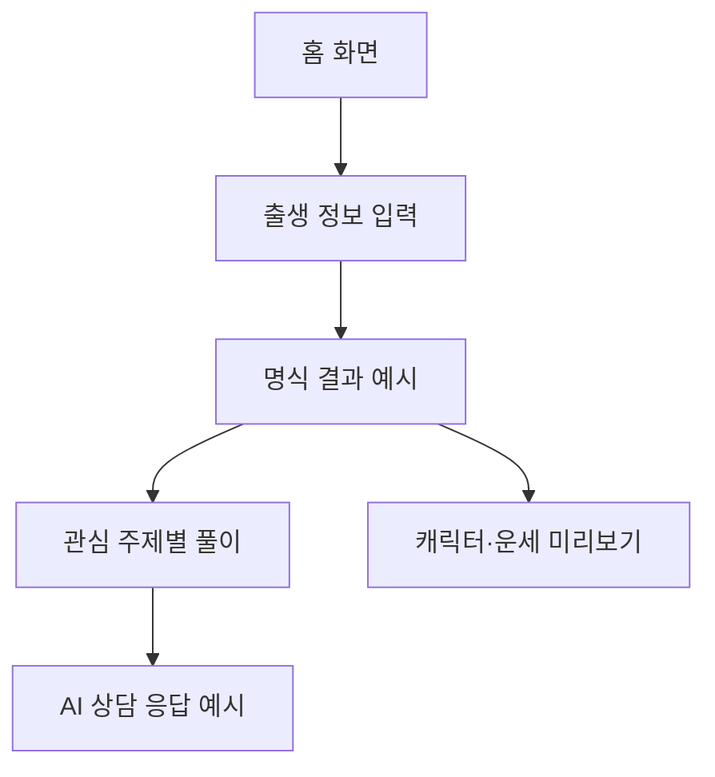
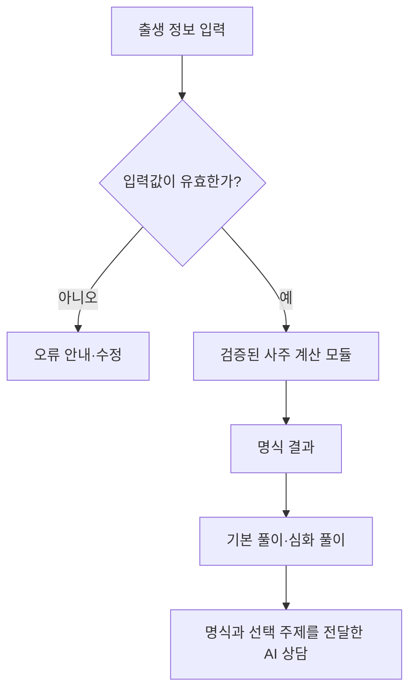

# 포포(POPO) ✦

**AI 사주 상담 웹 서비스**

> 나를 읽는 AI 사주 상담

개인 프로젝트 · 서비스 기획 / 인터랙티브 웹 목업 제작 중  
기록 기준일: 2026-10-29

**현재 확인할 수 있는 것:** 출생 정보 입력 화면, 명식 예시, 주제별 풀이, 캐릭터와 토정비결 미리보기, AI 상담 응답 예시를 클릭형 화면으로 확인할 수 있습니다.  
**아직 구현하지 않은 것:** 실제 사주 계산, AI 모델 연동, 회원·상담 기록 저장, 사용자 인터뷰와 사용성 테스트입니다.

---

## 1. 프로젝트 소개

포포는 사용자가 자신의 사주를 어렵지 않게 이해하고, 연애·직업·재물 등 관심 있는 주제로 풀이를 읽은 뒤 AI에게 질문할 수 있도록 기획한 웹 서비스입니다.

처음에는 사주 정보를 얼마나 자세히 보여줄지 고민했습니다. 하지만 항목을 많이 늘리는 것보다 **사용자가 원하는 정보를 쉽게 찾고, 이해되지 않는 부분을 다시 물어볼 수 있는 흐름**을 만드는 데 우선순위를 두었습니다.

현재는 기획 문서와 클릭형 웹 목업을 만들어 둔 상태입니다. 실제 계산과 AI 상담은 연결하지 않았고, 화면의 명식과 답변은 모두 예시 데이터입니다.

## 2. 문제 정의와 근거

기획 단계에서 다음 문제를 가설로 정리했습니다.

| 구분 | 내용 |
|---|---|
| 관찰한 내용 | 기존 사주 서비스는 상세 풀이, 캐릭터, 오늘의 운세 등 여러 콘텐츠를 제공하고 있습니다. 공개 소개 자료를 참고했습니다. |
| 문제 가설 1 | 사주를 처음 보는 사용자는 오행·십성 등 전문 용어를 이해하기 어려울 수 있습니다. |
| 문제 가설 2 | 사용자는 전체 풀이를 처음부터 읽기보다 관심 있는 주제를 먼저 찾아볼 수 있습니다. |
| 문제 가설 3 | 정해진 풀이를 읽다가 궁금한 점이 생기면 같은 명식을 바탕으로 추가 질문하고 싶을 수 있습니다. |
| 아직 확인하지 못한 것 | 실제 사용자의 불편, 기능 선호도, 화면 탐색 시간과 이탈 원인 |

이 문제들은 아직 사용자 인터뷰로 확인한 사실이 아닙니다. 경쟁 서비스의 공개 기능을 참고해 가설을 세웠고, 이후 인터뷰와 사용성 테스트에서 확인할 계획입니다.

자세한 내용: [프로젝트 개요](docs/01-product-brief.md) · [경쟁 서비스 검토](docs/09-competitive-benchmark.md)

## 3. 핵심 기능과 구현 상태

| 기능 | 현재 상태 | 확인 가능한 범위와 남은 작업 |
|---|---|---|
| 홈·메뉴 이동 | 클릭형 목업 | 주요 콘텐츠와 이동 흐름 확인 가능 |
| 출생 정보 입력 | 클릭형 목업 | 입력 화면과 선택 UI 제작. 실제 역법 검증·계산은 미연결 |
| 사주 명식·오행 표시 | 예시 화면 | 목업 데이터 표시. 계산 엔진 선정 및 검증 필요 |
| 기본·심화 풀이 | 클릭형 목업 | 카테고리 이동과 설명 수준 전환 예시. 실제 해석 규칙 검증 필요 |
| AI 사주 상담 | 응답 예시 | 상담 화면과 가상 답변 제공. 실제 모델 호출·세션 연결 미구현 |
| 60갑자 캐릭터 | 데이터 구조 기획 | 일주별 ID 60개 정리. 캐릭터 60종 일러스트 및 해석은 미제작 |
| 오늘의 운세·대운·세운 | 기획·일부 미리보기 | 날짜와 계산 정책 검증 후 구현 예정 |
| 토정비결 | 기획·미리보기 | 사주와 별도 계산·해석 규칙 검토 필요 |
| 타로·회원·기록 관리 | 후속 기획 | 핵심 MVP 이후 검토 |

운세 콘텐츠는 `내 사주 / 시간의 흐름 / 관심 주제 / 새해 특집`으로 구분했습니다. 연애·재물·인간관계·직업·학업·재회·건강 관련 콘텐츠도 이 구조 안에서 검토하고 있습니다.

**우선순위:** 먼저 출생 정보 입력 → 명식 결과 → 기본·심화 풀이 → AI 후속 상담을 연결하고, 캐릭터·운세·토정비결은 계산 정책과 구현 범위를 확인한 뒤 확장할 계획입니다.

상세 요구사항: [PRD 기준선 요약](docs/02a-prd-v0.3-baseline-summary.md) · [기능 확장 제안](docs/02-prd-v0.4-proposal.md) · [기능 목록](docs/03-feature-catalog.csv)

## 4. 서비스 흐름

### 현재 목업에서 확인할 수 있는 흐름

화면 전환과 문구는 미리 준비된 가상 시나리오입니다. 출생 정보를 입력해도 실제 사주 계산을 수행하지 않고, AI 응답도 모델에서 실시간으로 생성하지 않습니다.

### 앞으로 구현할 목표 흐름

명식 계산은 AI 모델에 맡기지 않고 별도의 계산 모듈로 처리할 계획입니다. 계산 결과, 전통 해석, AI가 생성한 설명을 구분하는 것도 핵심 요구사항입니다.

자세한 내용: [정보 구조와 사용자 흐름](docs/04-ia-and-flows.md) · [계산·해석 정책](docs/07-calculation-content-policy.md)

## 5. 사용 도구

| 구분 | 활용 범위 |
|---|---|
| Markdown·GitHub | 기획 문서 관리, 변경 이력, 공개 포트폴리오 정리 |
| HTML·CSS·JavaScript | 설치 없이 확인할 수 있는 인터랙티브 화면 목업 |
| CSV·Markdown | 기능 목록, 테스트 시나리오, 진행 상태 기록 |
| Python | 정적 사이트 구성·파일 구조 점검용 스크립트 포함 |
| ChatGPT | 기획 문서 초안 정리, UI 목업 및 자료 제작 보조 |

현재 사용한 도구와 **앞으로 도입을 검토할 기술**은 구분해 기록합니다. 실제 사주 계산 라이브러리, 운영 DB, AI 모델과 API는 아직 선정·연동을 완료하지 않았습니다.

## 6. 검증 현황

| 확인 항목 | 현재 결과 | 해석과 한계 |
|---|---|---|
| 경쟁 서비스 기능 검토 | 공식 공개 자료를 바탕으로 일부 기능 확인 | 전체 앱 화면 및 세부 정책 검증은 추가로 필요 |
| 화면 목업 | HTML·CSS·JavaScript로 화면과 예시 흐름 제작 | 실제 명식 계산 및 AI 연동 테스트는 아님 |
| 사주 계산 정확성 | 검증 전 | 엔진·역법 기준·경계 사례 테스트 필요 |
| AI 상담 품질 | 평가 시나리오 작성 | 실제 모델 응답 평가 미실시 |
| 사용자 인터뷰 | 계획 작성 | 실제 인터뷰 미실시 |
| 사용성 테스트 | 과제와 지표 설계 | 수행 결과와 개선 효과 미측정 |

지금 작성한 QA 시나리오는 **실행 계획**입니다. 앞으로 실제 테스트를 수행하면 기대 결과, 실제 결과, 발견한 문제, 수정 사항을 별도로 기록할 예정입니다.

관련 자료: [QA 테스트 시나리오](qa/01-test-cases.csv) · [실행 기록 양식](qa/02-execution-template.md) · [AI 평가 계획](docs/12-ai-evaluation-plan.md)

## 7. 산출물 안내

| 영역 | 자료 |
|---|---|
| 프로젝트 개요 | [문제 정의·타깃·차별화](docs/01-product-brief.md) |
| 기능·요구사항 | [PRD 확정 기준 요약](docs/02a-prd-v0.3-baseline-summary.md) · [확장 제안](docs/02-prd-v0.4-proposal.md) · [기능 목록](docs/03-feature-catalog.csv) |
| 설계 | [정보 구조·사용자 흐름](docs/04-ia-and-flows.md) · [화면설계 보완](docs/10-screen-spec-addendum.md) · [디자인 원칙](docs/06-design-system.md) |
| 캐릭터 | [60갑자 캐릭터 기획](docs/05-character-system.md) · [일주 ID 목록](data/60-day-pillar-character-map.csv) |
| 테스트·검증 | [요구사항·테스트 연결표](docs/11-requirement-test-evidence-matrix.csv) · [QA 시나리오](qa/01-test-cases.csv) · [사용자 조사 계획](research/01-interview-guide.md) |
| 변경·진행 관리 | [기획 의사결정](docs/08-decision-log.md) · [진행 상태표](PROGRESS.md) |
| 기업 제출 | [프로젝트 요약](portfolio/PROJECT_SUMMARY.md) · [포트폴리오 PDF](portfolio/포포_기업제출용_서비스기획_포트폴리오_v0.6.pdf) · [발표용 PPT](portfolio/포포_기업제출용_서비스기획_포트폴리오_v0.6.pptx) |

README에는 전체 파일을 반복해서 나열하지 않고, 필요한 문서만 연결했습니다. 그 외 검토 자료와 정책 문서는 [`docs/`](docs/)에서 볼 수 있습니다.

## 8. 현재 구성과 테스트 방법

현재 목업은 별도 설치 없이 브라우저로 확인할 수 있습니다.

1. 저장소에서 파일을 내려받거나 ZIP으로 다운로드합니다.
2. `prototype/index.html` 파일을 브라우저로 엽니다.
3. 출생 정보 입력, 카테고리 이동, 기본·심화 보기, 캐릭터·토정비결 미리보기, AI 상담 예시 화면을 확인합니다.

- [목업 HTML 파일](prototype/index.html)
- [모바일 UI 미리보기 이미지](_site/assets/ui-mobile-preview.png)
- [GitHub Pages 설정 안내](GITHUB_UPLOAD_GUIDE.md)

GitHub Pages를 설정하면 웹 주소로도 공개할 수 있습니다. **현재 README에 라이브 서비스 주소를 적지 않은 이유는 공개 배포 완료 여부를 확인하지 않았기 때문입니다.**

목업에서 보이는 명식, 캐릭터 설명, 운세, 상담 답변은 가상 예시입니다. 실제 출생 정보로 결과를 계산하거나 상담 API를 호출하지 않습니다.

## 9. 프로젝트 역할과 기여

개인 프로젝트로 진행하고 있으며 서비스 방향과 우선순위, 브랜드 및 화면 경험을 검토하고 GitHub에 기획 산출물을 정리하고 있습니다.

| 구분 | 수행 범위 |
|---|---|
| 기획 방향 | 사주 중심 서비스, 쉬운 풀이·심화 보기, AI 후속 상담 흐름 선택 |
| 기능·범위 결정 | 비회원 체험을 포함한 핵심 기능과 캐릭터·운세·토정비결의 확장 방향 검토 |
| 브랜드·UX | '포포(POPO)' 명칭과 슬로건 선택, 귀여운 캐릭터와 신비로운 디자인 방향 설정 |
| 자료 검토·공개 | 기획 자료와 화면 목업 검토, GitHub README 및 포트폴리오 구성 정리 |
| AI 활용 | 문서 초안·화면 목업·발표자료 제작을 보조받고, 최종 서비스 방향과 표기 내용을 검토 |
| 향후 수행 | 사용자 인터뷰, 실제 기능 구현 검증, QA 실행, 수정·재시험 |

실제 사용자 조사 결과나 배포된 제품 성과가 없는 단계이므로, 아직 수행하지 않은 활동을 완료한 것처럼 표현하지 않습니다.

## 10. 개인정보 및 공개 원칙

- 목업에는 실제 사용자의 출생 정보나 상담 내역을 사용하지 않습니다.
- 공개 저장소에 API 키, 비밀번호, 계정 인증 정보, 개인 상담 기록을 올리지 않습니다.
- 캐릭터·이미지·문구의 사용 권리와 외부 자료 출처를 검토합니다.
- 재회 관련 콘텐츠는 타인의 감정을 단정하지 않고, 건강 관련 콘텐츠는 의료적 판단을 대신하지 않습니다.
- 사주·타로는 전통 문화·엔터테인먼트 콘텐츠이며 과학적으로 입증된 미래 예측 방법으로 안내하지 않습니다.

공개 점검 항목: [공개 자료 체크리스트](docs/14-public-release-checklist.md)

## 11. 다음 작업과 완료 기준

| 순서 | 우선 작업 | 완료 기준 |
|---|---|---|
| 1 | 인터뷰와 사용성 테스트 준비 | 질문지·과제·관찰 기준 정리, 실제 수행 결과 기록 |
| 2 | 핵심 사용자 흐름 보완 | 입력 → 명식 이해 → 풀이 → AI 질문의 혼란 지점 확인·수정 |
| 3 | 역법·토정비결 계산 정책 검증 | 계산 엔진 후보와 검증 사례를 비교하고 적용 규칙 결정 |
| 4 | 핵심 기능 구현 | 실제 계산 결과·해석·AI 상담을 연결하고 오류 처리 |
| 5 | QA 및 결과 기록 | 테스트 실행, 실패 원인·수정·재시험 결과 정리 |
| 6 | 확장 기능 개발 | 일주 캐릭터, 오늘의 운세 등 P1 범위부터 순차 검토 |

최종 목표는 화면을 예쁘게 만드는 데 그치지 않고, **왜 이런 기능과 흐름을 선택했는지 설명하고 실제 사용성 검증 결과로 개선점을 보여주는 것**입니다.

---

**참고 자료:** [삐삐사주 공식 소개](https://ppippi.me/about) · [포스텔러](https://app.forceteller.com/) · [한국민족문화대백과 — 토정비결](https://encykorea.aks.ac.kr/Article/E0059207)
