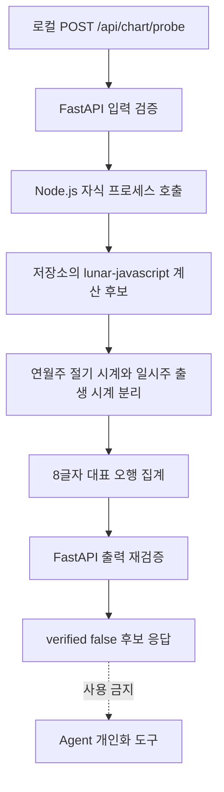

# POPO MVP Stage 3 — FastAPI 사주 계산 후보 서버 연결 (2026-11-02)

## 목적 및 상태

- **상태:** 구현 패치·로컬 오프라인 테스트 완료, **GitHub 실제 JS 라이브러리 기반 CI 통합 테스트 전**.
- 11월 10일 MVP 핵심 요구사항인 `출생정보 → 계산 → 구조화된 데이터 → AI 상담` 중 **FastAPI → 기존 JS 계산 엔진** 경로를 먼저 연결한다.
- 이전 브라우저 QA: 2A 26/26, 2B 156/156, 2C 24/24, 2D 16/16 PASS (모두 검증 범위 제한). 증거 `evidence/stage2d-kst-16-pass-2026-11-02.png`.
- **개인 사주 정확성 승인: NO.** `verified=false`, `can_personalize=false` 고정. Chat Agent `get_saju_chart()`는 여전히 `unavailable`이다.

## 선택한 구현 방식

- 프런트엔드: 기존 HTML/CSS/JS **미변경**. 사용자의 Figma 작업과 충돌하지 않음.
- 웹 API: FastAPI 기존 `backend/main.py`에 **POST `/api/chart/probe`** 추가. 실제 사용자 대상으로 공개하지 않는다.
- 계산: `backend/chart_bridge.cjs` (Node 22 이상 권장)가 `prototype/vendor/lunar.min.js`와 `prototype/calc-core.js`를 **서버에서 재사용**한다. Python이 새 만세력 알고리즘을 재구현하지 않는다.
- 역법 정책(미승인): 기존 후보 입력 제약(양력, 1990~2040, 3~9일 차단, 23:00~00:59 차단, 서울/부산/대전, 시간 필수)을 서버에서 중복 검증한다. 한국 표준시를 가정한다.
- 연·월주: 출생 KST 민간 시각에서 **60분을 빼서 라이브러리의 중국식 절입 시계를 조회하는 시도**. 이 가설의 2026년 12개 월주 경계는 Stage 2D에서 확인했으나 **모든 연도를 검증한 것은 아니다**.
- 일·시주: 원래의 출생 KST 시각을 그대로 사용한다. 절기 시차를 출생 시간 전체에 일괄 적용하지 않는다. 지역 경도·균시차·시주 날짜 경계는 별도 검증 필요.
- 프로브 결과는 서버 생성 후보 데이터이지만 **공식적으로 검증된 명식이 아님**. 발급된 chart_id도 없고 AI 프롬프트·도구 출력에 사용하지 않는다.
- 계산 입력은 로컬 서버로 전송되지만 별도의 저장 기능은 없다. 공개 배포 시 개인정보 처리 및 접근 제한 정책이 필요하다.

## 데이터 흐름



## API 계약

`POST /api/chart/probe`

```json
{
  "calendar": "양력",
  "date": "2000-01-01",
  "time": "12:00",
  "place": "서울",
  "unknown_time": false
}
```

성공 응답에는 `status: candidate_only`, `verified: false`, `can_personalize: false`,
`pillars.{year,month,day,hour}`, `counts.{wood,fire,earth,metal,water}`,
`engine`, `probe_version`, `policy`, `limitations`가 포함된다. 검증된 `chart_id`는 없다.

- 입력 오류 422: 지원하지 않는 날짜·음력·지역·자시·출생시간 미상·초과 필드.
- 실행 환경/계산 오류 503: Node.js 미설치, 라이브러리 누락, 자식 프로세스 오류 등. 세부 스택/개인정보는 응답에 출력하지 않는다.
- 공개 API로 노출하지 않는다. CORS는 기존 로컬 출처만 허용하며 이를 인증으로 오인하지 않는다.

## 테스트 현황

| 항목 | 현재 결과 | 범위 |
|---|---|---|
| 백엔드 기존 10건 | PASS | 기존 Stage 1 모의 OpenAI 계약 |
| 새 API 입력/신뢰/예외 11건 | PASS | 모의 subprocess / TestClient |
| 실제 JS 번들 통합 1건 | 로컬에서 SKIP | 실제 GitHub 저장소 CI에서 수행 예정 |
| Node bridge 구조 3건 | PASS | 임시 모의 계산 라이브러리, 실제 역법이 아님 |
| Node 원본 번들 통합 | 미실행 | GitHub Actions `chart-probe-stage3.yml`에서 검증 예정 |

GitHub 업로드 이후 **CI 결과와 실제 API 시험을 확인하기 전에는 구현 완료로 단정하지 않는다**.

## 배포 전 안전선과 다음 단계

1. Stage 3 자동 CI에서 실제 고정 라이브러리 입력→출력과 FastAPI 422/503 계약 확인.
2. 한국천문연구원/독립 만세력에서 절기·시주·지역시간·음력 정책의 검증 가능한 지원 범위 확정. `verified=true` 전환은 별도 승인.
3. 서버가 만든 `chart_id`를 보호해 저장하고 `get_saju_chart`에서 검증된 차트만 로드할 수 있게 변경.
4. 기존 `prototype/app.js` 입력/결과/상담 핸들러를 서버 API에 단계적으로 연결. Coming Soon 범위 분리.
5. 실제 모델 API 1회 테스트, 사용량/공개 접근 제한, 배포 및 엔드투엔드 QA.

**기획 의사결정:** 구현 속도 때문에 계산 정확성 기준을 낮추지 않으며, 미검증 값을 AI 상담에서 말하지 않도록 신뢰 경계를 API에 드러낸다.
